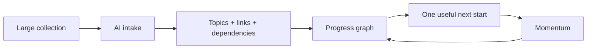
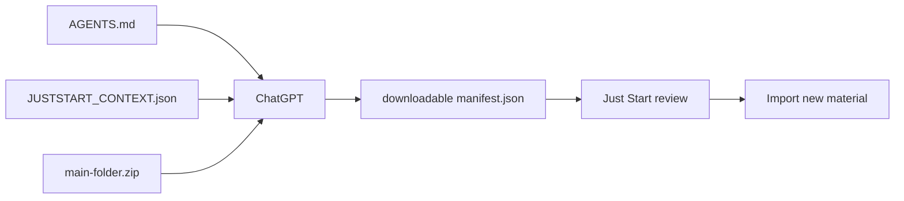
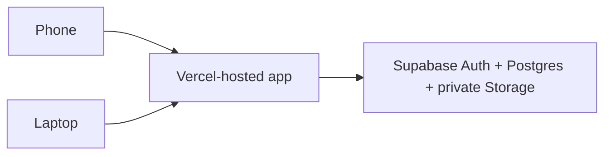

# Just Start

> **Reducing Friction by instantly starting.**

Just Start is a cloud-synced, AI-assisted learning workspace that turns a
messy collection of resources into a clear next step.

## The idea

Learning usually fails before the learning begins: too many files, unclear
priorities, forgotten deadlines, and no confidence about what to do next.



Just Start reduces the setup resistance **and** keeps the user moving:

- **Less friction:** import a whole folder or ZIP instead of adding resources one by one.
- **More awareness:** deadlines, importance, unlock value, startability, and prerequisites influence the next recommendation.
- **A little spark:** the user does not have to decide everything. The app reveals one useful next action.
- **Visible progress:** completion fills the graph and makes dependencies understandable.
- **Cloud continuity:** the same workspace follows the user between laptop and phone.

## What the experience looks like

### 1. Start with one useful action

The Start screen surfaces a recommended resource instead of an intimidating
plan. It considers urgency, importance, prerequisite state, and expected
unlock value, then gives the user a clear action to begin.

### 2. See the shape of the work

The Graph view shows:

- Nodes connected by prerequisite arrows.
- Independent topics grouped without artificial links.
- Progress-filled nodes.
- Click-to-inspect details.
- Drag and zoom for large collections.

### 3. Track without micromanaging

Users can mark work partially done, complete, skipped, or completed elsewhere.
The app keeps the path honest while preserving momentum.

### 4. Let AI handle the boring first pass

Download these two files from the app:

```text
AGENTS.md
JUSTSTART_CONTEXT.json
```

Give them to ChatGPT together with the user's main folder or ZIP. ChatGPT
creates and attaches a downloadable `manifest.json` containing only new
resources, new topics when needed, and evidence-backed dependencies.



The importer validates paths, URLs, IDs, missing references, cycles, and
duplicate resources before anything is added. Existing topics and resources
are reused or skipped.

### 5. Sign in once, continue anywhere

Email magic-link sign-in connects the workspace to Supabase:



After deployment, the laptop does **not** need to stay on. Local development
does require the laptop to run the development server; production does not.

## Included features

- Completion-aware recommendations.
- Deadline and prerequisite tracking.
- Interactive dependency graph.
- Smart Import for folders, ZIPs, files, links, papers, and YouTube URLs.
- Downloadable `AGENTS.md` and `JUSTSTART_CONTEXT.json`.
- Safe browser ZIP unpacking with path-traversal protection.
- Supabase email sign-in, workspace sync, and private resource storage.
- Responsive PWA experience for phone and laptop.
- Dark mode, local fallback, and an Electron desktop shell.

## Quick start

Requirements: Node.js `22.23.3` and npm `10.9.9`.

```bash
npm ci
cp .env.example .env
npm run dev
```

Open the URL printed by Vite.

For phone testing on the same Wi-Fi:

```bash
npm run dev:network
```

Open `http://<laptop-ip>:5173` on the phone. This local URL requires the
laptop to remain on.

## Supabase configuration

Run `supabase/schema.sql` in the Supabase SQL Editor, then put only these
browser-safe values in `.env`:

```env
VITE_SUPABASE_URL=https://your-project-ref.supabase.co
VITE_SUPABASE_PUBLISHABLE_KEY=sb_publishable_your-key
```

Never put a Supabase secret/service-role key in the frontend or repository.
The `.env` file is ignored; `.env.example` is safe to commit.

## Deploy for laptop-off phone access

Vercel free is sufficient:

1. Push the `main` branch to GitHub.
2. Import the repository into Vercel.
3. Use `npm ci` as the install command.
4. Use `npm run build` as the build command.
5. Use `dist` as the output directory.
6. Add `VITE_SUPABASE_URL` and `VITE_SUPABASE_PUBLISHABLE_KEY` in Vercel.
7. Add the Vercel HTTPS URL to Supabase Auth's allowed URLs.

Then open the same Vercel URL on the phone and laptop and sign in with the
same email. Supabase provides the shared data while Vercel provides the app.

## Build and test

```bash
make test
npm run build
```

`make test` is the single offline test command after dependencies are
installed. The project also includes:

- `package-lock.json` for reproducible npm installs.
- `.nvmrc` for the pinned Node runtime.
- `Dockerfile` for clean Linux builds and serving.
- `.env.example` without secrets.
- No machine-specific absolute paths.

## Recording a short demo

1. Start on **Start** and show the recommended next action.
2. Open **Graph** and drag/zoom through the dependency map.
3. Click a node to show progress, deadline/resource details, and prerequisites.
4. Open **Smart import** and download `AGENTS.md` plus `JUSTSTART_CONTEXT.json`.
5. Show the compact resource card instead of the old empty preview.
6. Open **Sign in to sync** and explain that the same workspace works on phone and laptop.

The message of the demo is simple: **remove the friction, reveal the next
start, and keep the momentum visible.**
